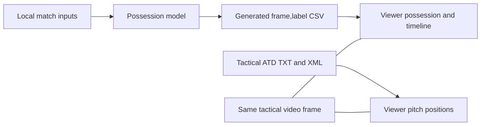

## Context

Reviewing a model-generated possession CSV needs the predicted label and its spatial context at the same tactical video frame. A map can otherwise suggest that its player and ball coordinates were generated or corrected by the possession model. This PR adds the local viewer and makes that distinction explicit in the guide, the UI and this description.

## Which data is used?

**Yes: the viewer uses the CSV generated by the possession model.** The submission contract is `frame,label`: 199,319 rows, one per tactical video frame, with H, A, D or X. It contains **no player or ball coordinates**.

| What the team sees | Source |
|---|---|
| Current H/A/D/X label, label timeline, recent runs and window H/A share | The model-generated CSV selected with `--predictions` |
| Solid player markers and the ball position | Original tactical ATD TXT, interpreted with its XML metadata |
| Optional dashed player markers | Separately marked, display-only estimates from nearby tracking observations |



The authorised local session used `salidas/viewer-real/candidate_a.csv`, generated by `solution.a_opus` with its default configuration. Another model's CSV can be loaded through the same flag; the viewer does not automatically choose the latest experiment and does not run inference.

**The CSV is loaded once at startup.** After generating a new output, stop the viewer and restart it with `--predictions` pointing to that file. Changing a CSV on disk does not update the running session.

## Synthetic illustration


**Every position and label in this illustration is invented.** This SVG shows the current viewer design: midnight background, locally embedded typography, blue/pink teams, lime ball, label window and optional dashed player estimates. It is not footage, tracking or a prediction sequence from the restricted match. No real-match screenshot, CSV, video or tracking extract is included in this PR.

## What changed

- Read-only Python server on `127.0.0.1`, strict metadata/ATD and CSV validation, a bounded byte-offset index and bounded browser requests/cache. Fixed asset allowlist, origin/Host checks, no telemetry/CDN, no persistent match cache or export.
- Canvas pitch with frame-aligned model labels, precise playback, stepping, seeking and speed controls. Labels retain H/A/D/X; a missing ball, abstention and no loaded CSV are distinct states. Window percentages describe only H/A predictions in the preceding 40 seconds within the half, excluding D/X; they are not official evaluation metrics.
- Local styling follows the team's website colours and typography, with bundled font licences. The website repository was used only as a read-only reference; its pitch component is not replaced or integrated.
- Optional player interpolation for bounded gaps up to two seconds, with continuity, speed, duplicate and team-capacity checks. Longer losses may get only a 0.6-second decelerating fade. Dashed markers, a separate count and a toggle distinguish estimates from observations. The ball is never interpolated or extrapolated.
- Synthetic fixtures, Python/clock/browser tests, a synthetic-only browser CI workflow, a current-design SVG illustration and opt-in local verification that emits only sanitised errors and aggregates. All repository workflows explicitly use `ubuntu-24.04` rather than `ubuntu-latest`.

## How to review

With Python 3.11+ and the shared dependencies installed:

```sh
python -m tools.match_viewer --synthetic
```

Open `http://127.0.0.1:8765/`. For an authorised local bundle and a previously generated CSV:

```sh
python -m tools.match_viewer --data-dir /local/match-bundle --predictions /private/results/candidate.csv --port 8768
```

The bundle must contain the tactical XML/TXT pair. See the linked guide for setup, Docker checks, exact interpretation and privacy boundaries.

## Validation and limits

- After incorporating `main` at `76bdb97`, **98 shared Docker tests pass**, including all 21 viewer tests; three JavaScript playback tests and synthetic desktop/mobile browser checks pass. Zero external requests and browser errors were observed. The regenerated SVG was also checked for valid XML, self-contained fonts, current colours and rendered missing-ball/player-estimate/fade states.
- Authorised local verification checked all **199,319 frames**. Ball coordinates and absence masks agree with the existing ATD reader, and display estimation preserves every original observation. Local browser checks passed forty seeks, ball canvas/source parity, a nonempty estimate compared with the original view, playback, pause and mobile layout. Only aggregate findings are shared; detailed match material stays local and ignored.
- Reader and rendering consistency do **not** prove that an automatic ball detection matches the physical ball in the video. Missing observations and tracking errors remain possible. Player slots do not guarantee stable identities, and display estimates are not corrected ground truth.
- The map and submission CSV use the tactical video timeline. Broadcast/TV footage has a separate timeline with cuts and replays; matching elapsed times does not align the two recordings.
- No candidate implementation, official metric, generated prediction CSV or model configuration is changed. Human football review and teammate acceptance remain pending.

Refs #34. Keep the issue open until the remaining acceptance checks in the guide are completed.
